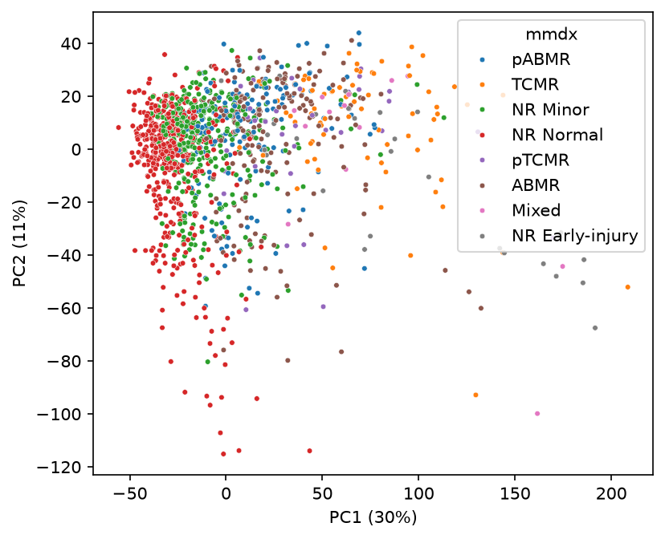
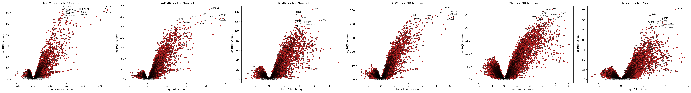

# transplant-rejection-ml

> **Status: work in progress.** Data loading, exploratory analysis and differential expression are done. Classification models are next.

Exploring heart transplant rejection from endomyocardial biopsy gene expression, in Python: from public GEO data to differential expression and, next, a leakage-safe classifier.

## Data

- **Source:** [GSE150059](https://www.ncbi.nlm.nih.gov/geo/query/acc.cgi?acc=GSE150059) (GEO), heart transplant endomyocardial biopsies profiled by microarray (ClinicalTrials.gov NCT02670408).
- **Samples:** 1,320 biopsies, each with a Molecular Microscope Diagnostic System (MMDx) diagnosis.
- Data are downloaded by `notebooks/01_fetch_data.ipynb` and are not stored in this repository.

| MMDx diagnosis   |   n |    % |
|:-----------------|----:|-----:|
| NR Normal        | 462 | 35.0 |
| NR Minor         | 359 | 27.2 |
| ABMR             | 179 | 13.6 |
| pABMR            | 161 | 12.2 |
| TCMR             |  76 |  5.8 |
| pTCMR            |  38 |  2.9 |
| NR Early-injury  |  32 |  2.4 |
| Mixed            |  13 |  1.0 |

NR: no rejection. ABMR: antibody-mediated rejection. TCMR: T cell-mediated rejection.

## Analysis so far

| Notebook | What it does |
|:--|:--|
| `01_fetch_data.ipynb` | Downloads the GEO series matrix |
| `02_load_eda.ipynb` | Loads expression and sample metadata, cleans labels, exploratory PCA on the 5,000 most variable probes |
| `03_differential_expression.ipynb` | limma differential expression of each MMDx group against `NR Normal`, gene annotation from the GEO platform record, volcano plots |





Top 20 genes per comparison: [`tables/de_top20_per_comparison.csv`](tables/de_top20_per_comparison.csv)

## Methods

- **Expression:** series matrix values as deposited on GEO; Affymetrix control probes removed.
- **Differential expression:** linear models with empirical Bayes moderation (limma), using [python-limma](https://pypi.org/project/python-limma/), a pure-Python port of Bioconductor limma.
- **Annotation:** probe to gene symbol from the platform (GPL) table; probes mapping to several genes take the first listed symbol.

## Repository structure

```
notebooks/   analysis notebooks, run in numbered order
src/         reusable functions (GEO series matrix reader)
figures/     final figures shown in this README
tables/      small summary tables
data/        downloaded data (not tracked)
results/     full outputs, regenerated by the notebooks (not tracked)
```

## How to reproduce

```bash
git clone https://github.com/abhi8138/transplant-rejection-ml.git
cd transplant-rejection-ml
conda env create -f environment.yml
conda activate rejection-ml
```

Then run the notebooks in `notebooks/` in numbered order.

## Limitations

- MMDx diagnoses are derived from biopsy gene expression, so models predicting MMDx groups from the same data are partly circular. The modelling target will be chosen with this in mind.
- Single cohort, no external validation yet.
- python-limma is a young port; results are being checked against R limma.

## Next steps

- Penalised logistic regression (elastic net) with feature selection inside nested cross-validation
- Compare python-limma output with R limma on one comparison
- Fit all groups in a single limma model with contrasts

## License

Code: see [LICENSE](LICENSE). Data: see the GEO record for terms of use.